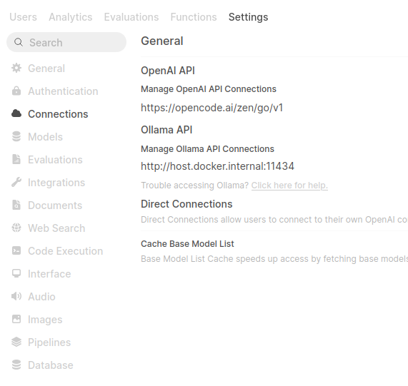
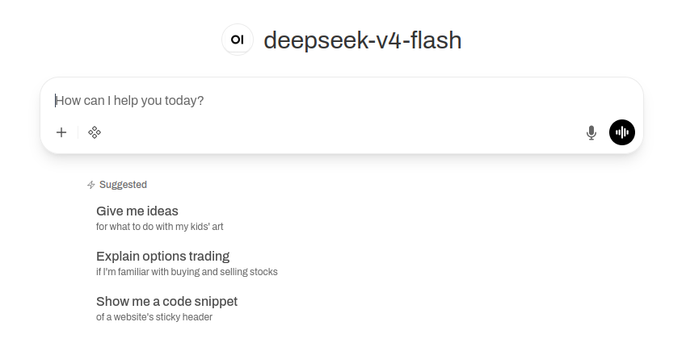

I've been a member of the Ollama discord for a while now, and I've noticed that when people talk about Ollama Cloud they frequently compare it against OpenCode Go. As the Ollama free tier allowance has constrained over time (and my free tier GitHub Copilot went the same way), I finally bit the bullet and _paid_ for AI using OpenCode's subscription product for only \$5 in the first month ($10 afterwards).

## What is OpenCode Go?

From the [website](https://opencode.ai/go), the monthly subscription service describes itself as offering low cost pricing, generous limits and reliable access to lots of open source AI models. I've been using for less than a month and, compared with my frugal experience of Copilot at work, it feels like trying to drink from a fire hose. I've struggled to dent my 5 hour session limits with the larger models like GLM5.2, let alone with the cheaper (yet very capable) models like DeepSeek V4 Flash and Mimo-v2.5. 

## What is OpenWebUI?

[OpenWebUI](https://docs.openwebui.com/) is an open-source, web-based interface for interacting with large language models (LLMs). It can connect to local models via Ollama but we'll be looking more at its ability to connect to remote providers through OpenAI-compatible APIs. Either way, you have a ChatGPT-like experience that you can self-host.

I discovered OpenWebUI when I was looking for a quick way of chatting with an LLM that could access a knowledge base (a school organiser agent to track all the many activities). I've only scratched the surface of what it can do, but I'm particularly impressed with the calendar integration and the ability to set reminders.

## Don't trust AI folklore

As an example of the first AI propagated myth I ever noticed, I was repeatedly told by Haiku, Mistral and blogpost alike that Go could only be used within OpenCode itself. I saw a similar pattern where conventional wisdom held that Claude Code couldn't be used with Ollama models. Thankfully I see the internet has bebunked [both](https://docs.ollama.com/integrations/claude-code) [myths](https://opencode.ai/docs/go/). OpenCode Go is just another provider that conforms to the openAI chat completions standard. Let me share how I set up OpenCode Go as a provider in OpenWebUI as an example you can follow in most other harnesses you'll come across.

## Prerequisites
In order to follow along you will need:

* A valid OpenCode Go account.
* An instance of OpenWebUI. Mine is running in a docker container on a Raspberry Pi on my local network, with exposed port 3000 (accessed using either the ip address plus port or e,g., raspberrypi.local:3000). 

Whilst Docker and single board computers can sound scary, OpenWebUI is really easy to set up. You can just run the following docker command: 

`docker run -d -p 3000:8080 --add-host=host.docker.internal:host-gateway -v open-webui:/app/backend/data --name open-webui --restart always ghcr.io/open-webui/open-webui:main`

>[!TIP]
> If you are thinking of signing up to OpenCode Go anyway, why not use my referral and gain $5 usage? Click on the link here: https://opencode.ai/go?ref=PZ0DW75QJY

## Connection details
Assuming you have admin credentials, log in to OpenWebUI, and then find the Admin Panel menu item under your user icon. Go to Settings, then Connections.

This is what it should look like when you are done.

Under "Manage OpenAI API Connections", click the plus sign. It is an external connection, the authentication type is a bearer token and the API type is chat completions, all of which are the defaults anyway.

Like all other openAI compatible providers, the form of the URL ends in "v1": `https://opencode.ai/zen/go/v1`. Put this in the URL field.

Finally, you will need to log in to opencode.ai/go and generate an API key. I would recommend generating a new one per service so you can delete in the case that one of your devices or logins are compromised. Copy and paste this API key from the OpenCode Go settings into your OpenWebUI configuration. 

All that is left is to verify the connection and start chatting away!

